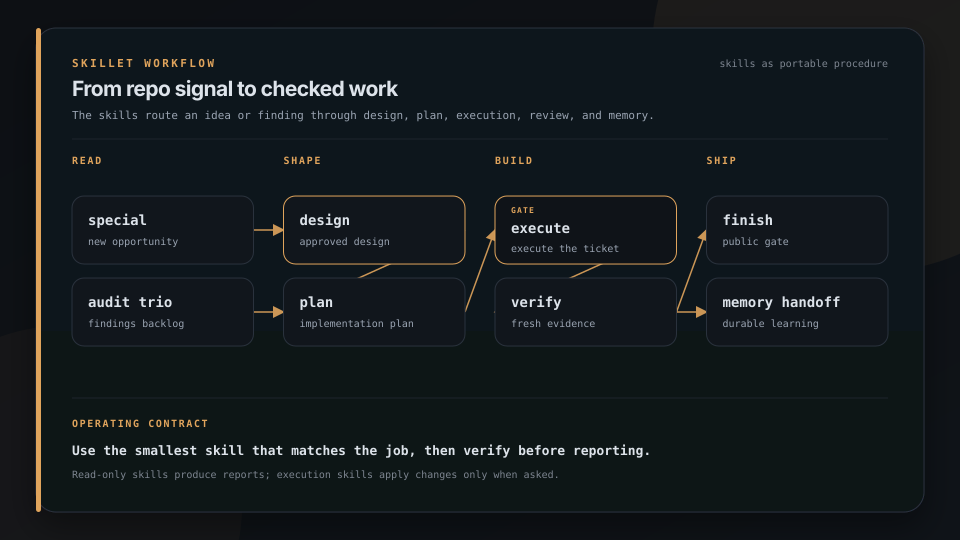

<p align="center">
  
</p>

<h1 align="center">skillet</h1>

<p align="center">
  
</p>

<p align="center">
  <strong>A skillet full of agent skills that actually ship work.</strong>
</p>

<p align="center">
  Production-tested SKILL.md workflows for audits, bug hunts, security sweeps, publish gates, releases, and memory handoffs. Auto-trigger across Claude Code, Codex, and compatible harnesses.
</p>

<p align="center">
  <a href="https://brigade.tools/skillet">Website</a> &middot; <a href="#install">Install</a> &middot; <a href="#the-skills">The skills</a> &middot; <a href="https://brigade.tools">Brigade hub</a>
</p>

<p align="center">
  
  
  
</p>

## Install

```bash
# Claude Code plugin marketplace
/plugin marketplace add escoffier-labs/skillet

# any npx skills-compatible harness
npx skills add escoffier-labs/skillet

# or via Brigade skills station
brigade add skills
```

Skillet no longer ships general workflow skills. Several skills hand off to [Superpowers](https://github.com/obra/superpowers) skills by name, such as `superpowers:systematic-debugging` or `superpowers:test-driven-development`, so install Superpowers alongside skillet. Without it, those handoff steps have no target. Every other step in each skill still applies.

## What it does

| | Job | What you get |
|---|---|---|
| **Audit** | See what matters first | repo-audit, bug-hunt, security-sweep, latent-premises, retry-safety with priority-sorted backlogs |
| **Ship** | Gate what goes public and get PRs merge-ready | publish-readiness, garnish, release-cut, publish-scrub, merge-ready |
| **Execute** | Plan, build, upgrade, and measure | stocktake, thermometer, reduce, fleet-conductor |
| **Remember** | File what you learned | memory-handoff compatible with Brigade; relief for in-flight task state |


## Try it in 60 seconds

```bash
# Any `npx skills`-compatible harness
npx skills add escoffier-labs/skillet --list   # see every skill without installing
npx skills add escoffier-labs/skillet          # install the roster
```

Then ask your agent naturally, or invoke a skill directly:

```
/repo-audit        # seven-area repo audit, priority-sorted backlog
/security-sweep    # defensive security audit, each finding with a prescribed fix
/publish-readiness # leak scan before a repo goes public
```

## The skills

### The audit roster

Six skills, one report contract ([docs/audit-report-format.md](docs/audit-report-format.md)). Run any of them alone, or all six over time. The findings compose into a single priority-sorted backlog.

| Skill | What it does |
|-------|--------------|
| **repo-audit** | Reviews seven audit areas (docs, agent-readiness, tests/CI, hygiene, structure, release hygiene, TODO mining), scores each, and delivers a backlog sorted by impact relative to effort. Brigade-aware: if the repo uses [brigade](https://github.com/escoffier-labs/brigade), its handoff and memory health get audited too. |
| **bug-hunt** | Correctness sweep across five lenses with mandatory adversarial verification. Only bugs that survive a refutation attempt make the report, each with a concrete trigger. |
| **security-sweep** | Defensive security audit: secrets (tree and history), dependency CVEs, injection surfaces, authn/authz, exposure. Every finding ships with its remediation. |
| **mcp-server-review** | Read-only security review of one MCP server, one you build or one you are about to install. Eight lenses: tool inventory and gate consistency, transport and auth, process execution, credentials, TLS and SSRF, output fencing, tool description integrity, supply chain. Reports in the security-sweep spine. |
| **latent-premises** | Hunts the assumptions code takes for granted that nothing enforces: input shape, callee contracts, environment, ordering, cardinality. A finding needs a nameable break and ends with one resolution arrow (guard it, document it, or encode it in the type). The forward-looking counterpart to bug-hunt. |
| **retry-safety** | Checks whether a diff's side effects survive a second run: database writes, migrations, network mutations, payments, queue consumers. The standard is idempotent read-modify-write at the side-effecting edge, and migrations also get the deploy-window lens (expand-migrate-contract). |

The audit roster is read-only by design. **fix-findings** is the step that closes the loop:

| Skill | What it does |
|-------|--------------|
| **fix-findings** | Takes an audit backlog and drives it to done: highest-priority finding first, one focused change at a time, each one verified before the next, parking anything destructive or breaking for you to decide. The execution partner to the audit roster. |

### The line

Portable process skills for planning, building, debugging, reviewing, maintaining, and finishing code changes.



Generated from [`docs/assets/workflows/daily-workflow.json`](docs/assets/workflows/daily-workflow.json) with `plating workflow`. Design and plan use `superpowers:brainstorming` and `superpowers:writing-plans`. Execution uses `superpowers:subagent-driven-development` or `superpowers:executing-plans`. Verification uses `superpowers:verification-before-completion`. Finishing uses `superpowers:finishing-a-development-branch` plus the repo's own PR rules.

| Skill | What it does |
|-------|--------------|
| **research-brief** | Produces a read-only factual brief from a scoped question, dated source register, claim-to-source map, recorded disagreements, and a fresh citation-support pass. Reports inaccessible and unchecked evidence instead of filling gaps. |
| **special** | The chef's special: walks the repo for what is possible rather than what is broken, and proposes net-new features grounded in evidence already in the code (unfinished work, asymmetries, adjacent capability, friction, ecosystem fit). Read-only, priority-sorted, every proposal tied to a signal in the walk-in and cut if it is ungrounded or fights a stated non-goal. The opportunity-finding counterpart to the audit roster. A chosen special feeds `superpowers:brainstorming`. |
| **stagiaire** | A cook visiting from another kitchen: dispatches one-shot workers on other vendors' CLIs (cursor-agent, grok, codex, claude, agy, ollama, opencode, pi) over the user's own logins, with the exact headless flags and the silent-failure trap for each. One model call per dispatch, no API keys. Points at brigade's roster when dispatches become routine. |
| **reduce** | Behavior-preserving simplification: boils the excess off code you just changed and concentrates the intent without altering what it does. Establishes a behavior lock (tests green before and after) before touching anything, refuses load-bearing redundancy and premature abstraction, applies one category per commit, and hands correctness or design issues to bug-hunt, security-sweep, or repo-audit. Applies by default, drops to a report when behavior cannot be locked. |
| **stocktake** | Dependency and toolchain maintenance: inventories manifests, lockfiles, runtime pins, CI pins, and the resolved graph before changing one compatibility boundary. Reads maintainer release and migration notes, reviews transitive deltas, and verifies the final resolved versions. |
| **thermometer** | Measured performance work: pins a workload and metric, collects multiple baseline samples, profiles the bottleneck, changes one hypothesis, and compares the same samples again without trading away correctness. |
| **pr-security-review** | Security review scoped to a diff: a PR, commit range, or staged changes. Traces each changed input to its sink and covers OWASP classes plus CI/CD workflows, new dependencies, agent and LLM surfaces, SSRF, deserialization, crypto, and security-relevant literals. Reports secrets by location and type only, treats PR text as attacker-controlled, and opens with a block, fix-before-merge, or ok verdict. Read-only. |
| **merge-ready** | Drives an open PR to merge-ready from a declared mode (drive, background, threads-only, check), working conflicts, then review threads, then CI in one batched push. Classifies a CI failure before any retry (a flake earns one fresh run, an identical second failure was never a flake, a failure outside the diff means a stale base). Skipped or stale reviews are not approval, and merge-ready never authorizes the merge. Adapted from pstack (MIT). |
| **brief** | Decision-ready BLUF answers: leads with the judgment, keeps the basis on screen, and splits recommendation from report so an observed result does not get a confidence marking. |
| **fleet-conductor** | Conducts large backlogs and multi-repository campaigns with bounded lanes, explicit held triggers, collision records, draft-readiness gates, and GitHub merge evidence. Preserves human branches and requires operator approval for competing valid approaches. |
| **supply-chain-harden** | Hardens a repository's software supply chain as one reviewable branch, one commit per control: actions pinned to commit SHAs, least-privilege workflow tokens, workflow injection fixes, grouped Dependabot, zizmor and gitleaks in CI, npm trusted publishing with provenance, digest-pinned Docker bases, `.env` ignores, and `SECURITY.md`. Never weakens an existing check. Fleet mode hands one lane per repo to fleet-conductor. |
| **pressure-test** | Drives a plan or design to explicit decisions before anyone builds, one decision at a time, each pinned to its basis. Includes sous mode: going AFK? The agent makes the reversible calls in your place, tags each answer evidence/constraint/judgment, parks anything it can't take back, and leaves you an auditable transcript. |
| **release-cut** | Changelog roll-up, semver bump, tag, GitHub release, drafted announcement. Releases on request, never per feature. |
| **memory-handoff** | Ends a session by writing durable knowledge into a structured handoff a memory owner can review and file. Pairs with brigade, works standalone. |
| **relief** | The shift change: pauses in-flight work at a safe boundary with a local wip checkpoint (named files, never on the default branch, never pushed) and an untracked resume note, or picks work up by reading the trail, rebuilding state from git, picking a verdict, and verifying inherited claims on the real artifact. Task state only; durable findings still go through memory-handoff. Adapted from pstack (MIT). |
| **lineage** | Why does this code exist: git archaeology (blame, pickaxe, PR bodies and review threads, ADRs, tests), Brigade evidence searched first, five confidence tiers from direct to unknown, mechanics kept apart from motivation, and a Preserve / Change / Avoid / Risk close before an edit. Adapted from pstack (MIT). |
| **mistake-proof** | Prevents repeated agent mistakes: mines commits, reverts, and review threads for classes (twice counts), fixes each at the highest working level (remove the capability, types, a lint whose error names the replacement, a test, docs last), proves each check fails on a real past mistake, and keeps a rule-to-enforcer table. Report first, apply an approved subset. Adapted from pstack (MIT). |
| **hone** | Deepens a prompt or worker brief before it is sent: what a top practitioner would do, the rawest source material, the methods and tools, and independent proof of correctness. Rewrites without deciding the author's open choices and without running the task. Adapted from pstack (MIT). |
| **ticket-rail** | Issue intake and repro gate: frozen source coordinates, whole-thread reading, a bounded cause trace, classification, four dedupe outcomes, create only for a clear live net-new bug. An existing PR or claimed fix means hold or verify, never a competing patch, and no confirmed repro means no authored fix. Internal verdict by default. Adapted from pstack (MIT). |
| **test-kitchen** | Creates and maintains a project-local verify skill that drives the real app: launch, read-only doctor, drive recipes with stable handles, evidence rules, cleanup that kills only what the run started, and a feature map. Maintain mode ends clean, changed, or blocked and never edits product code. Runs only on request. Adapted from pstack (MIT). |
| **create-formal-verification-skill** | On explicit request, creates a project-local formal verifier for one code-backed property, with source mapping, bounds, a broken control, and a tracked sync revision. Adapted from pstack (MIT). |
| **maintain-formal-verification-skill** | On explicit request, reconciles existing formal checks with changed source, separates model drift from bugs, and preserves properties unless an intentional contract change is evidenced. Adapted from pstack (MIT). |
| **statechart** | On explicit request, draws user-visible Mermaid charts and counterexample stories from TLA+ models, compares code with agreed behavior or fixes, and scaffolds models from charts. Bundled offline tests use Node.js. TLC and PNG rendering require separately installed tools. Adapted from pstack (MIT). |
| **diagnose-session** | Evidence-first diagnosis of a misbehaving agent run: intake before analysis, current-project transcripts only, every finding cites path:line, every number computed, human turns only count as prompts, context-safe extraction, redaction before sharing. Starts with plan adherence, repeated work, and cost and time. Runs only on request. Adapted from obra/superpowers (MIT). |
| **t3-code** | Sets up and troubleshoots T3 Code across Linux and Windows machines: project state, saved environments, headless services, Windows Scheduled Tasks, direct Tailnet access, Tailscale Serve, local SSH tunnels, updates, launchers, and icons. |

### Plating

Publication gates for prose, video, site metadata, and whole repositories.

| Skill | What it does |
|-------|--------------|
| **publish-scrub** | The last look before prose goes public: scrubs a blog post, social draft, PR body, or commit message for internal hostnames, private IPs, leaked paths, and AI-authorship disclosures, applies writing conventions, and previews every change before editing the author's voice. |
| **grill** | Hardens a technical post for Hacker News, Lobsters, or another skeptical audience. Checks claims, sources, numbers, title framing, and the objections likely to appear in comments, then hands the draft to publish-scrub. |
| **reel-check** | Checks rendered reels, screen recordings, and demo videos for identity or infrastructure leaks in both source text and sampled frames, then verifies the new render. |
| **garnish** | Audits or fixes portable website metadata: titles, descriptions, canonical URLs, robots policy, Open Graph, structured data, sitemaps, and rendered output. Project-local policy supplies domains and account values. |
| **publish-readiness** | The gate before a repository goes public: working-tree and git-history leak scans, hygiene checks, and the history-rewrite recipe for content that already leaked. |

### Appliances

These skills operate optional tools. They remain top-level skill packages, but their procedures only apply when the named tool is installed and configured.

| Skill | What it does |
|-------|--------------|
| **graphtrail** | Answers structural code questions from a GraphTrail index: callers, callees, impact, file neighbors, context, and before/after graph changes. Falls back to text or syntax tools when the question is not graph-shaped. |
| **brigade-handoffs** | Sets up and checks [brigade](https://github.com/escoffier-labs/brigade) handoff inboxes for repos and agent workspaces, writes linted local drafts, reviews the pending queue, and keeps canonical memory changes review-gated. |

## Usage

Ask naturally ("audit this repo", "is this safe to publish", "cut a release") or invoke directly:

```
/repo-audit
/security-sweep
/brigade-handoffs
/pressure-test   (add "answer your own questions, I'm going afk" for sous mode)
```

repo-audit, bug-hunt, security-sweep, latent-premises, retry-safety, and research-brief are read-only by design. The audit skills produce reports and backlogs; research-brief produces sourced findings. **fix-findings** is the separate, opt-in step that applies audit fixes, parking anything destructive or breaking for you to decide.

## Why not something else?

- **A single mega-prompt or one big `CLAUDE.md`** works until it bloats past the context budget and goes stale, and it loads every instruction on every turn whether the work matches or not. skillet is one self-contained file per job that triggers only when the work matches, so the audit procedure does not cost context while you are cutting a release.
- **Hand-rolling the procedure each session** means the gotcha you learned last month (the repo that published with hostnames in its history, the audit that produced a wall of unprioritized findings) is gone by the next session. Each skill encodes the procedure plus the hard-won gotchas so the floor stays raised.
- **A tool-locked agent framework** ties the workflow to one harness. skillet skills are plain `SKILL.md` files: they install into Claude Code, Codex, or any `SKILL.md`-compatible harness, per-machine or per-repo, the same way.
- **Native harness skill libraries** are great, and skillet is not a replacement for the harness. It is the roster of process skills you drop on top, with a shared report contract so the read-only auditors and the execution skills compose instead of each inventing its own format.

## What skillet is not

skillet is not an agent, a runtime, or a service. It does not:

- run anything on its own or install a daemon, scheduler, or background process
- run a standalone agent CLI or ship binaries. Some skills bundle scripts that run only when invoked
- install runtime dependencies or call out to the network on its own. Optional script tools and prerequisites are documented in each package
- replace your harness, your model, or your editor
- apply changes from read-only skills (repo-audit, bug-hunt, security-sweep, latent-premises, retry-safety, special, research-brief). Applying audit findings is the separate, opt-in **fix-findings** step
- cut releases automatically; **release-cut** runs on request, never per feature

The skills carry the procedure and the discipline. You stay in the loop for anything destructive, breaking, or public.

## Why these exist

Every skill here is extracted from a real workflow that broke or burned time the manual way: repos published with internal hostnames in the history, audits that produced walls of findings nobody prioritized, releases with mismatched versions, sessions whose hard-won knowledge died in the transcript. The skills encode the procedure plus the gotchas.

## Contributing

Bug reports, sharper skill triggers, and new skills are welcome. See [CONTRIBUTING.md](CONTRIBUTING.md) for the support scope and contribution path, [SECURITY.md](SECURITY.md) for reporting a vulnerability, and the [Code of Conduct](CODE_OF_CONDUCT.md).

## License

MIT. See [LICENSE](LICENSE).
